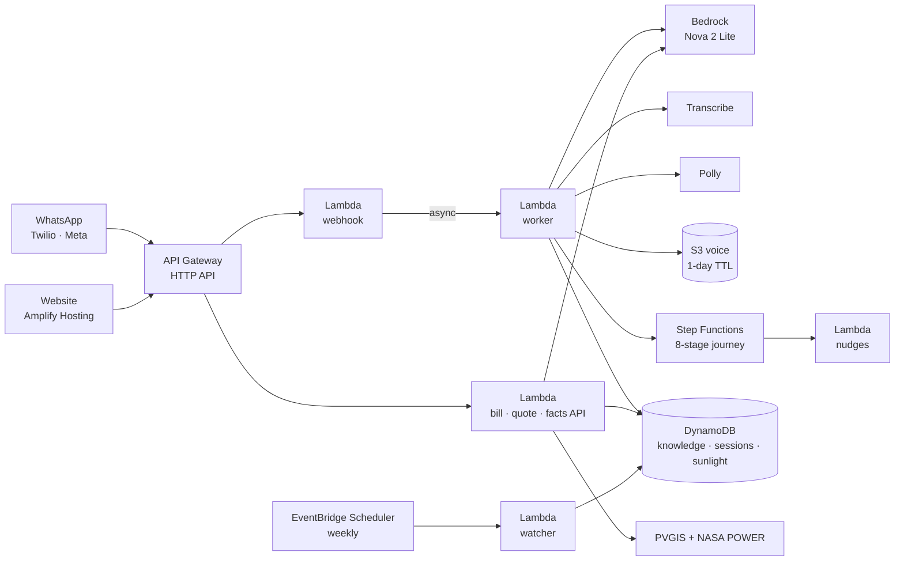

# Surya Saathi ☀️

**A rooftop-solar companion for Indian households, from the electricity bill to the subsidy in the bank, and after.** It works on WhatsApp in Hindi and English, by photo, text or voice note.

Built for the WeMakeDevs × AWS **Bharat Builds Tour: Environmental Hacks** · Track 3, Waste and Energy.

- **Website:** https://main.d3frlgja2w8q15.amplifyapp.com
- **WhatsApp:** Twilio sandbox, +1 415 523 8886 (send the join code first)
- **API:** https://26iznf3yc7.execute-api.ap-south-1.amazonaws.com

## The problem

India wants **1 crore** solar homes by March 2027 under PM Surya Ghar. About **41 lakh** were done by June 2026. A national survey of 17,000 homes (CEEW, June 2026) found that once people apply, most go on to install. **The drop-off happens before they apply**: they can't tell if it pays, who to trust, or what to do next. Three in four people who think solar is expensive don't know collateral-free loans exist.

The people who do go ahead hit traps:
- **Vendor traps:** non-DCR panels void the whole subsidy, and subsidy promises run above the scheme cap.
- **Paperwork rejections:** names that don't match across Aadhaar, the bill and the bank account.
- **Stalled steps:** net meters stuck for weeks, and subsidies held up by an unredeemed e-token.
- **After installation:** export units never credited on the bill (MNRE flagged this in July 2026), and output quietly lost to Delhi's dust and smog.

Delhi's newest deal goes unnoticed too. Homes using up to 400 units a month can now get **3 kW at ₹0 upfront** (Cabinet, Sep 2026), yet only about 10,000 of 2.3 lakh target homes are done.

## What it does

| Stage | What Surya Saathi does |
|---|---|
| **Decide** | **Bill photo → right size, cost after subsidy, EMI, payback, CO₂**, or an honest "skip". Months missing from the bill are estimated from local temperature. A smaller system wins when it gets within 10% of the best 25-year value. Delhi's ₹0-upfront and state top-up are flagged when they apply |
| **Save now** | **Bill doctor**: flags sanctioned load far above your actual peak (₹5,500/yr on our test bill), estimated readings, one-off charges, and missing export credit |
| **Choose** | **Quote checker**: non-DCR panels, subsidy over the cap, ₹/kW against live local prices, fewer panels than quoted, undersized inverter, short warranties, big advances, plus questions to ask the vendor |
| **Apply** | **8-step plan on Step Functions**, starting with a pre-flight check for the common rejections. A nudge when a step runs long. **STUCK** drafts a complaint for whoever is holding things up: helpline, then nodal officer, then grievance portal, then RTI. The household sends it |
| **Get paid** | E-token and claim-deadline reminders inside the same plan |
| **Keep it running** | **Inverter or app photo → output against what the panels should make** this month at this location: clean, check, or keep as warranty evidence |
| **No roof of your own** | **Flats and societies**: common-area solar at ₹18,000/kW, a calculator, and a ready message for the RWA |
| **Any question** | Typed or spoken, in Hindi or English. Voice note in (Transcribe), voice note out (Polly). Answers are grounded in the household's own estimate and the facts board |

## Knowledge that keeps itself current

Fuel surcharges, state top-ups and prices change every few months, so a hand-made table goes stale. Instead:

1. **Bills teach tariffs.** Every bill prints its own slab rates. Each one read updates that provider's tariff anonymously, and **a bill from any state works on day one**. On our real BSES Rajdhani photo, the reader recovers DERC's exact 200/400-unit slabs.
2. **Quotes teach prices.** Each quote checked adds a ₹/kW price for its state. The fair range becomes the middle half of recent local quotes.
3. **People verify facts.** The public "Rates & rules" board shows each fact's source, last confirmation and change reports. Anyone can confirm a fact or report a change with evidence, and three reports flag it for review.
4. **Watchers check sources.** An EventBridge Scheduler job re-reads official pages weekly and flags facts whose source changed.

## Architecture



- **AWS services:** Lambda, API Gateway, Bedrock, Step Functions, EventBridge Scheduler, DynamoDB, S3, Transcribe, Polly, Amplify Hosting, SSM Parameter Store, CloudWatch.
- **AWS open source:** deployed with **AWS SAM**, one template ([`template.yaml`](template.yaml)) in ap-south-1.
- **Reliable bill reading:** every bill is read **three times in parallel** and only what the readings agree on is kept. Phone photos of skewed tables otherwise drift, so this matters.

## How the numbers work

- **Sunlight:** PVGIS models a tilted system with losses, scaled down month by month wherever NASA POWER's satellite data is lower (north India's winter smog). That gives Delhi 1,482 units per kW a year, against 1,623 from PVGIS alone.
- **Bill:** built the way the bill prints it (slabs, fixed charge, fuel surcharge, 8% surcharge, pension surcharge, tax, Delhi's 200-unit subsidy). It reproduces a real BRPL bill within 3%, then gets calibrated on the bill's own energy charge.
- **Value:** every size is evaluated over 25 years: subsidy, collateral-free loan EMI, 0.5%/yr panel ageing, an inverter in year 12, discounted at 8%.
- **Estimates are labelled as estimates.** The aim is a trustworthy direction for a household, not a bank-grade valuation.

## Privacy

- **Bills:** the reader never asks for name, address, phone or consumer number, and bill images aren't stored.
- **Voice:** voice notes are deleted after a day.
- **What we keep:** the WhatsApp number, language, last estimate and journey stage, deleted automatically after 90 days.
- **Deleting:** **DELETE MY DATA** erases everything immediately.

## Run it

```bash
python -m venv .venv && .venv/Scripts/pip install pytest boto3 aws-sam-cli
.venv/Scripts/python -m pytest            # 108 tests, offline
sam build && sam deploy --guided          # the whole backend
python scripts/deploy_web.py              # the website, to Amplify
```

## Honest limits

- **The PM Surya Ghar portal has no API.** The journey guides and tracks the application; the household submits it.
- **WhatsApp:** Meta's Cloud API integration is built, but Meta only lets verified businesses reply, so the demo runs on Twilio's sandbox.
- **Nudges days apart** would need an approved WhatsApp template in production. Demo mode (`APPLY DEMO`) shortens a day to 4 seconds.
- **State top-ups outside Delhi** come from the community-verified facts board, which starts small.

## Built with

**AWS**, as above.

**AI tools:** Claude Code (Anthropic) helped with research, code and writing. Amazon Bedrock (Nova 2 Lite) runs inside the product.

**Data sources:**
- Sunlight: [PVGIS](https://re.jrc.ec.europa.eu/pvg_tools/en/) and [NASA POWER](https://power.larc.nasa.gov/)
- Grid emissions: [CEA CO₂ database v22](https://cea.nic.in/wp-content/uploads/baseline/2026/09/User_Guide__Version_22.0.pdf)
- Adoption: [CEEW rooftop solar study](https://www.ceew.in/sites/default/files/final-ceew-rts-study-press-release-4june26.pdf)
- Scheme and policy facts: listed with their sources in [`facts.json`](src/surya/data/facts.json)

MIT licensed.
