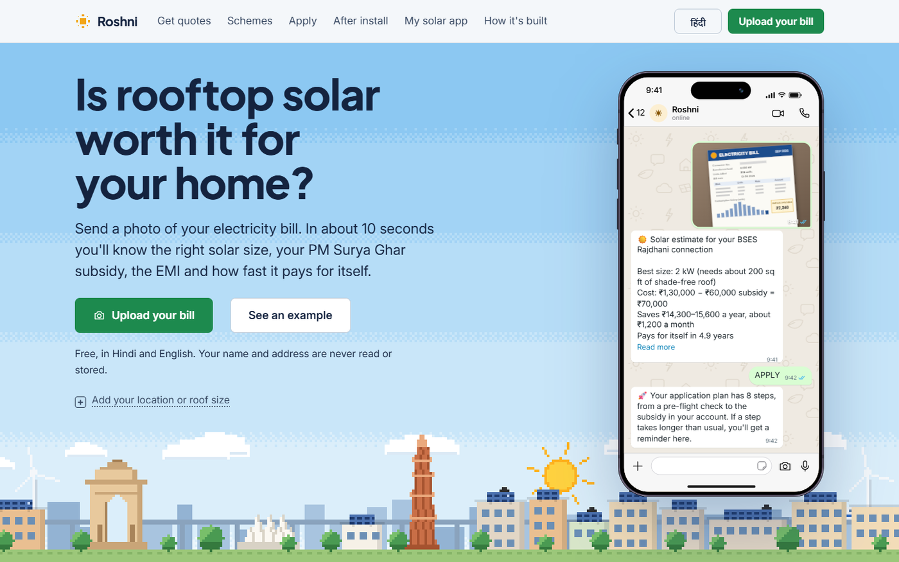
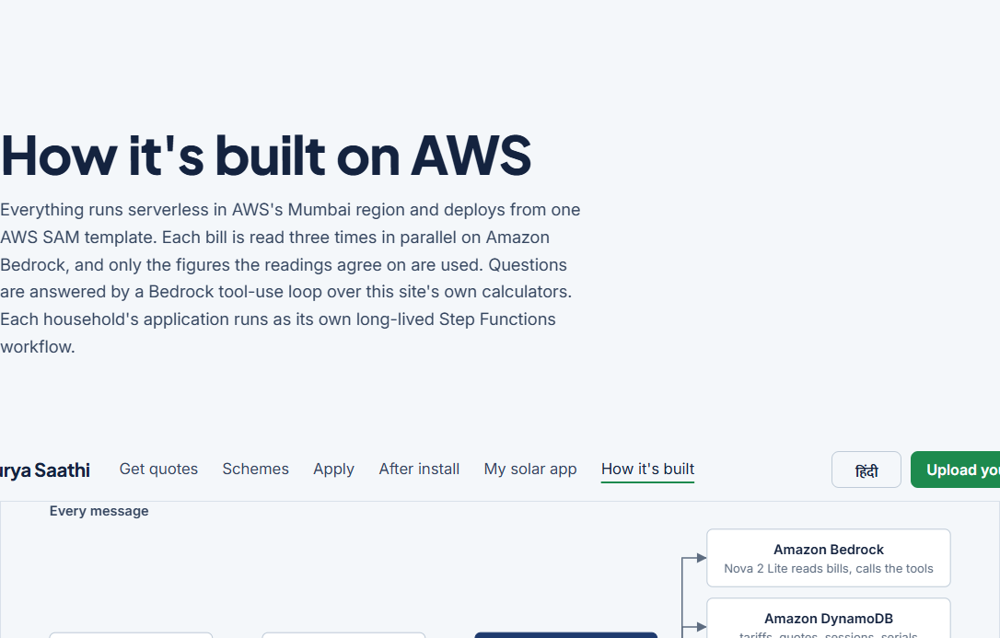
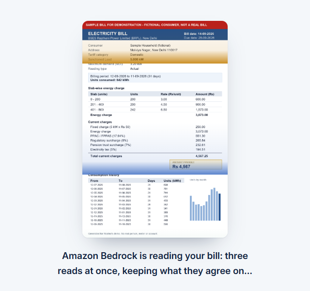
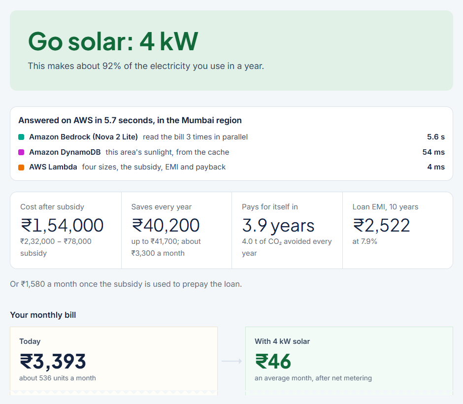
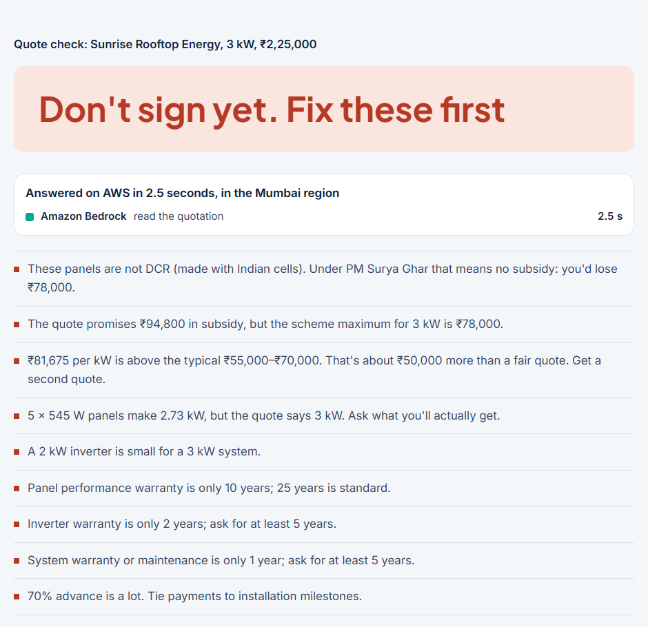
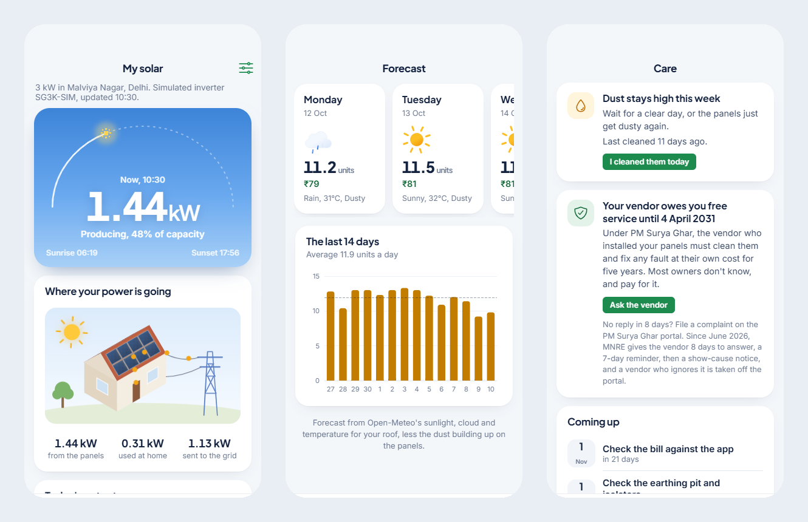

# Is rooftop solar worth it for my home? Building Roshni, a WhatsApp solar companion, on AWS

*A family sends a photo of their electricity bill on WhatsApp. Amazon Bedrock reads it three times in parallel, a Lambda works out the size, subsidy, EMI and payback, and the same companion checks the vendor's quote, walks the application, checks the panels and looks after them for 25 years.*

Three conversations I wanted this to handle well:

- **A ₹4,567 bill from Malviya Nagar.** The family has heard about "free electricity" and doesn't know whether it applies to them. Four seconds after the photo goes in, they know: 4 kW, ₹1,54,000 after the ₹78,000 subsidy, pays for itself in about 4 years, and their monthly bill falls from ₹3,393 to under ₹50.
- **A vendor quote for ₹2,25,000** that promises ₹94,800 of subsidy. The scheme's maximum for 3 kW is ₹78,000, and the panels in the quote are imported, which means no subsidy at all. Signing it would cost the family ₹78,000 they were counting on.
- **Panels that go quiet at noon on the sunniest day of the month.** Nothing is broken. Exports push the street's voltage past the inverter's cut-off. The owner needs to know whose job that is (the DISCOM's) and what evidence to send.

Roshni is built for all three, in Hindi and English, on WhatsApp where families already are.

## The problem isn't the subsidy. It's not knowing who to trust.

India wants one crore homes on rooftop solar under PM Surya Ghar by March 2027. By June 2026 about 41 lakh homes had it. A [CEEW survey](https://www.ceew.in/sites/default/files/final-ceew-rts-study-press-release-4june26.pdf) of 17,000 households shows where the rest stop: most families who apply go on to install. The drop-off is before they apply. They can't tell whether solar pays for their home, which vendor to trust, or what happens next.

After installation the trouble changes shape. On owner forums like [Team-BHP](https://www.team-bhp.com/forum/shifting-gears/234323-solar-power-turning-my-roof-power-plant.html), the same stories repeat: inverters on standby at midday, monitoring apps that go blank, installers and inverter companies blaming each other, and bills that don't show the units sent to the grid. In July 2026 MNRE [acknowledged complaints](https://www.energetica-india.net/news/mnre-flags-incorrect-rooftop-solar-billing-by-discoms-refers-complaints-for-resolution) about wrong bills after net metering, and in August it deactivated 66 vendors over pending applications.

So Roshni isn't a calculator. It's one companion for the whole path:

1. **Estimate** from a bill photo: the right size, the cost after subsidy, the EMI, the payback, or an honest "skip it".
2. **Check a quote** before signing, and compare quotes by what the family actually pays after subsidy.
3. **Apply**, eight steps on the national portal, with a reminder when a step runs long and a drafted complaint when someone else is holding it up.
4. **Check the panels** on the roof against the subsidy rules, from a photo of one label.
5. **Live with it:** an app for the panels, with the day to clean, every inverter event explained, and the five years of free service the vendor owes.

## Why these AWS services

Everything runs serverless in the Mumbai region (ap-south-1) and deploys from one AWS SAM template.

| Service | What it does in Roshni | Why this one |
|---|---|---|
| **Amazon Bedrock (Nova 2 Lite)** | Reads bills, quotes, inverter screens and panel labels with tool schemas, and answers questions through a tool-use loop | Vision and tool use in one model, inside the region, cheap enough to read every bill three times |
| **AWS Lambda** | The calculator, the bot logic and the simulated inverter cloud | Bursty traffic with long quiet stretches |
| **Amazon API Gateway (HTTP API)** | One API for the website, the app and both WhatsApp webhooks | Per-route throttling keeps the Bedrock routes inside budget |
| **AWS Step Functions** | Each household's application, as a long-running workflow | A stage waits on a task token until the family replies DONE; a late stage times out into a nudge |
| **Amazon EventBridge Scheduler** | A weekly watcher over official pages, and reminders | Schedules without a server |
| **Amazon DynamoDB** | Sessions, a sunlight cache, the knowledge layer, the quote marketplace | TTL expires old requests; single-digit-ms reads |
| **Amazon Location Service** | Turns "Saket, Delhi" into coordinates and a state; satellite tiles for tracing a roof | Places and maps inside AWS, with a referer-limited API key |
| **Amazon Transcribe and Amazon Polly** | Hindi voice notes in and out | Many users would rather speak than type |
| **AWS Amplify Hosting** | The website and the installable app | Static hosting with a CDN |
| **AWS Systems Manager Parameter Store** | WhatsApp and Twilio secrets, as SecureStrings | Nothing secret in the code or the template |

## What happens to a bill photo, step by step

The result page shows these steps with the times the API measured, so the AWS work is visible to the family as well as to me.

1. The photo is resized in the browser and sent to `POST /bill` with no name, address or account number ever requested from the model.
2. **Amazon Bedrock reads it three times in parallel** with the same tool schema. Single reads of a phone photo drift; three reads cost one read's latency.
3. A consensus step keeps what the reads agree on, field by field.
4. Months are counted back from the current billing period in printed order, because models read the units column reliably but scramble the history table's dates.
5. The bill's own slab table becomes that provider's current tariff.
6. Sunlight for the area comes from a DynamoDB cache (from PVGIS and NASA POWER the first time).
7. Lambda prices every size from 1 kW up to what the connection allows, against 25 years of output, the subsidy, a 7–8% loan and the tariff, and picks the smallest one within 10% of the best value.
8. A bill check-up runs on the side. On one real Delhi bill it found ₹5,500 a year of savings before any solar: the sanctioned load was double the actual peak.

## What broke, and what I changed

**Real bills aren't synthetic bills.** My first reader was right on a clean bill and wrong on a real phone photo. It read DD-MM dates as MM-DD, mistook the "days" column for units, and once used the bill total as the energy charge. Three changes fixed it: the prompt says *transcribe, don't interpret*; the code, not the model, decides which month a row belongs to; and every bill is read three times with a consensus. On a real Delhi bill it now gets all eight fields right.

**The model did arithmetic.** The first assistant pasted facts into the prompt. Asked about 3 kW in Lucknow, it multiplied Uttar Pradesh's ₹15,000 per kW by three and promised ₹45,000, past the state's ₹30,000 cap. Now questions go through a Bedrock tool-use loop over the product's own calculators: the scheme list for a state, a rough estimate, the scam check, the dust forecast and the household's application step. The tools return finished amounts, caps applied and written the Indian way (₹1,08,000), and every answer says which tools it used.

**WhatsApp's front door closed.** Meta's Cloud API integration took an afternoon: signed webhooks, an async worker, de-duplicated retries. Then Meta restricted the account until the business is verified, and a student project isn't a registered business. Twilio's WhatsApp sandbox took about an hour to add behind the same bot logic. Its quirks: a different signature scheme, media links that redirect to signed storage, and a 1,600-character limit per message.

**A cache that lived past midnight.** The dust forecast picks the first low-dust day after a dusty spell. One morning it still started on the previous day, because a response cached just before midnight was served after it. The cache now keys on the date in India.

**A test that spent real money.** A test patched the old assistant function, so the new one reached Bedrock with my own credentials. The test suite now refuses to create any real AWS client. It has 214 tests, all offline.

## After installation, an app for the panels

Once the panels are up, Roshni becomes "My solar", an app installable on a phone. Real inverter clouds need each brand's access, so the demo runs a **simulated inverter cloud on Lambda**. It isn't random. Output follows [Open-Meteo](https://open-meteo.com)'s sunlight, temperature and rain for the home's own location over the past month and the next three days, less dust that builds faster on dusty days and washes off in rain. Every screen says it's simulated.

What owners told forums and regulators shaped what it shows:

- **Every inverter event is explained.** Grid voltage too high, supply too low, a power cut, the Wi-Fi logger dropping out. Each comes with what it means, what to do, **who fixes it** (the DISCOM or the vendor) and a line of evidence to send them. That ends the blame game.
- **The vendor's free service.** Under PM Surya Ghar, the vendor must [clean the panels and fix faults free for five years](https://solar.delhi.gov.in/page/operation-and-maintenance-procedure). Most owners don't know. The app counts down that period, drafts the message to the vendor, and explains [MNRE's June 2026 complaint deadlines](https://solarquarter.com/2026/06/25/mnre-introduces-strict-sop-to-address-consumer-complaints-against-solar-vendors-under-pm-surya-ghar-scheme/) (8 days, a 7-day reminder, then a show-cause notice) if they don't answer.
- **The day to clean.** A CAMS dust forecast picks the first clear day after the dust settles, so cleaning isn't wasted.
- **Your roof, live.** An illustrated house shows the panels producing, the dust building up on them, and the power going to the home and the grid. It turns to night after sunset.

## Honest limits

- **The inverter is simulated.** Connecting real Growatt, Sungrow or Solis clouds needs each brand's API and the installer's access.
- **Tariffs are verified for Delhi's three DISCOMs.** Elsewhere the reader learns the slab rates from the bill itself.
- **Demo data is labelled.** The sample bill, the sample quote and the four vendors on the comparison board are fictional, and say so. I didn't want any real company shown with prices it never quoted.

## What I learned

1. **Let the code decide, and let the model read.** Every time the model did arithmetic or interpreted dates, it was confidently wrong. Transcription plus deterministic code was right.
2. **Three cheap reads beat one careful one.** Parallel reads with a consensus cost one read's latency and removed most errors on real photos.
3. **Build for the channel people already use.** A WhatsApp message in Hindi reaches a family that will never install an app before they install panels.
4. **Talk to owners before building features.** The most useful screens in the app (who fixes it, the free service) came from owner complaints, not from my guesses.

## What's next

- Connecting real inverter clouds, starting with the brands most common under PM Surya Ghar.
- Verified tariffs for more states, and group net metering for apartment societies.
- Moving WhatsApp from the Twilio sandbox to a verified business number.

## Try it

- **Demo video:** [Roshni in 3 minutes](https://youtu.be/REPLACE_WITH_VIDEO_ID)
- **Website:** https://main.d3frlgja2w8q15.amplifyapp.com (press "See an example" to watch Bedrock read a sample bill)
- **The app:** https://main.d3frlgja2w8q15.amplifyapp.com/app/
- **Code:** https://github.com/piyushk-dev/roshni

## AI tools used

- **Claude Code (Anthropic)** and **Codex (OpenAI)** as coding assistants, for research, code and writing.
- **Amazon Bedrock (Nova 2 Lite)** inside the product, to read bills, quotes, inverter screens and panel labels, and to answer questions with the product's own tools.

Built for the WeMakeDevs × AWS Bharat Builds Tour: Environmental Hacks, October 2026.
